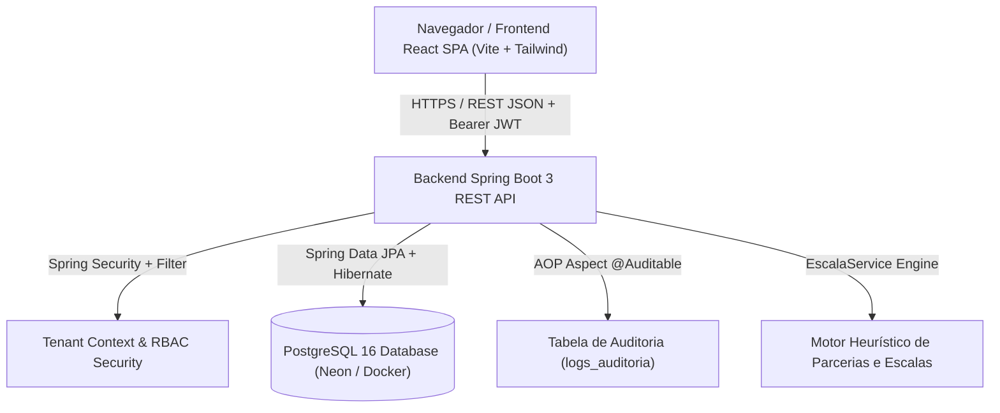
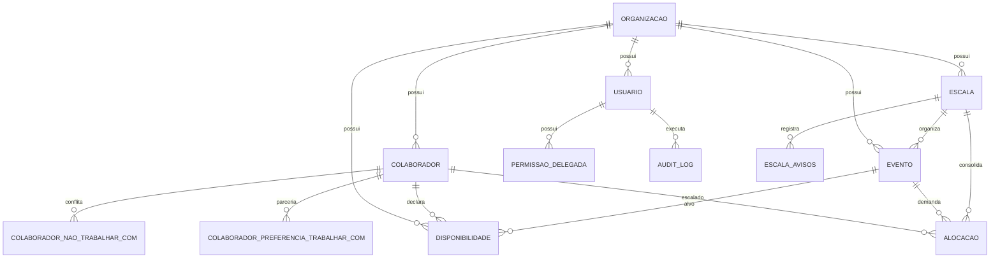
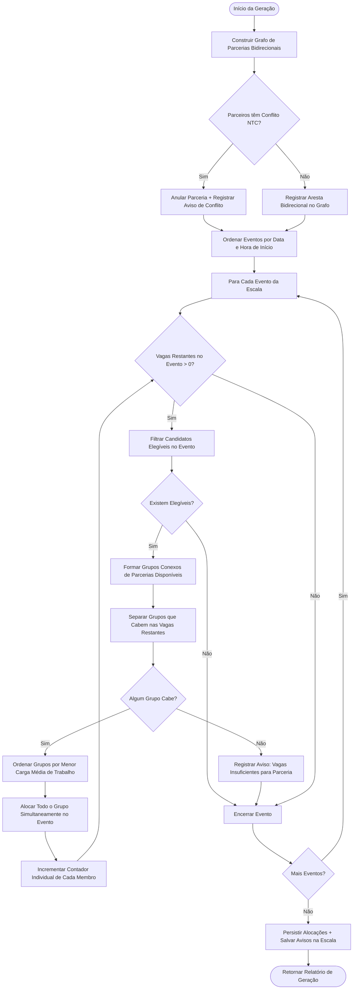
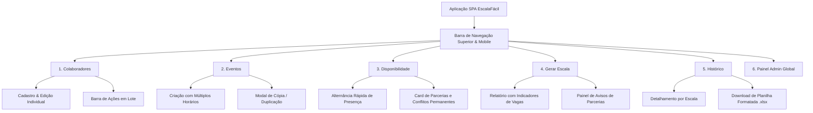
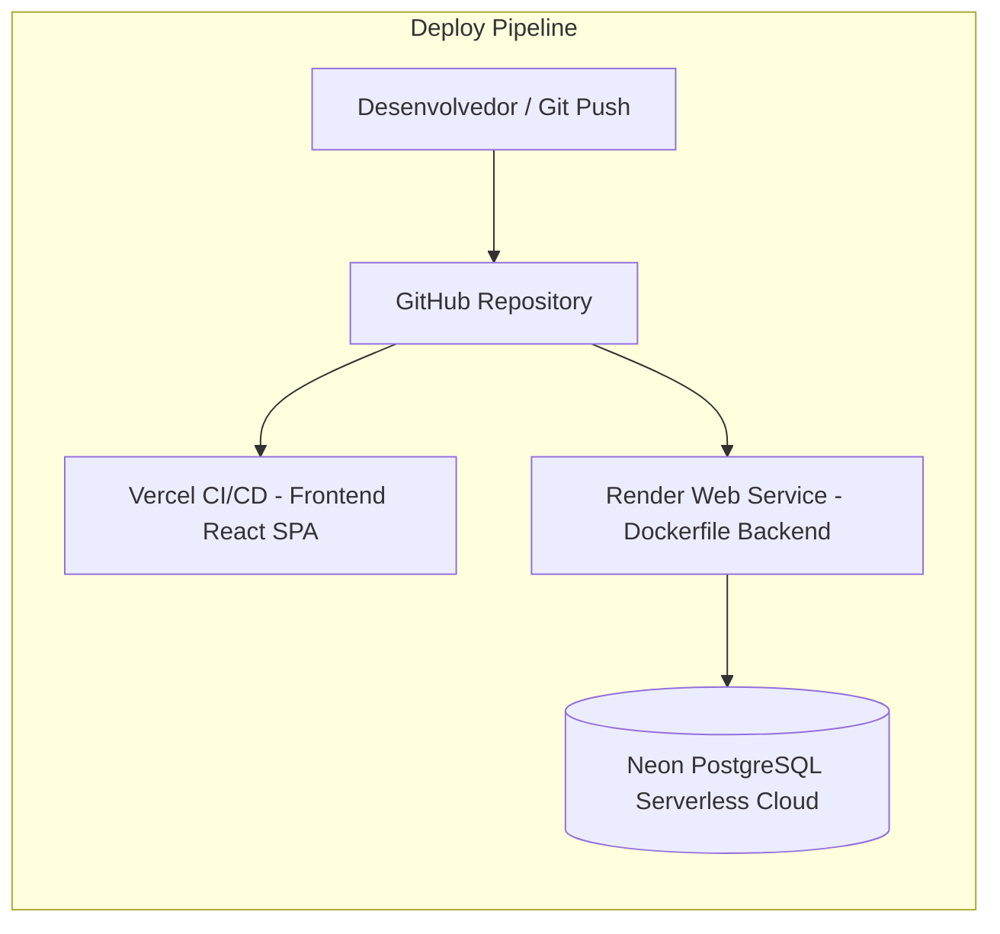

# 📐 Especificação Técnica e Funcional do Sistema (Spec-Driven)

**Sistema:** EscalaFácil - Gerador de Escala Automático  
**Versão do Documento:** 2.0.0  
**Status:** Especificação Completa de Produção  
**Padrão Metodológico:** Spec-Driven Development (SDD) / Especificação Técnica Orientada a Requisitos  
**Última Atualização:** Outubro de 2026  

---

## 📄 1. Visão Geral e Propósito do Sistema

O **EscalaFácil** é um sistema *SaaS Multi-Tenant* de alto desempenho projetado para automatizar, otimizar e auditar a alocação de colaboradores em escalas de trabalho, turnos litúrgicos e plantões operacionais (ex.: paróquias, ministérios de liturgia, instituições hospitalares, recepções e equipes de eventos).

### 1.1 O Problema
Processos manuais de geração de escala em planilhas ou cadernos sofrem com:
- Conflitos de agenda (colaborador escalado no mesmo dia/horário em múltiplos eventos);
- Sobrecarga de determinados colaboradores em detrimento de outros (falta de equidade);
- Dificuldade em conciliar indisponibilidades pontuais com regras de parceria e restrições de convivência;
- Falhas humanas na checagem de vagas e ausência de trilha de auditoria.

### 1.2 A Solução
O EscalaFácil resolve esse problema por meio de:
1. **Algoritmo Heurístico Determinístico de Distribuição Justa**: Distribui os plantões priorizando o menor workload individual acumulado.
2. **Motor de Parcerias Obrigatórias (Restrição Forte)**: Garante que colaboradores que solicitaram trabalhar juntos sejam escalados estritamente no mesmo evento quando houver disponibilidade coincidente, tratando pares mútuos e cadeias ($A \leftrightarrow B \leftrightarrow C$).
3. **Restrições Rígidas de Conflito ("Não Trabalhar Com")**: Regra soberana que impede que pessoas com atritos sejam escaladas juntas no mesmo evento.
4. **Isolamento Multi-Tenant**: Dados 100% segregados por organização, com segurança baseada em Spring Security e tokens JWT com invalidação instantânea.
5. **Auditoria e Transparência**: Registro automático de ações administrativas e geração de alertas explicativos caso vagas insuficientes impeçam o cumprimento de uma parceria.

---

## 🏗️ 2. Arquitetura e Stack Tecnológico

A aplicação adota o padrão **Monorepo**, dividida em duas camadas desacopladas (Backend REST API e Frontend SPA):



### 2.1 Backend (`/backend`)
- **Linguagem & Plataforma:** Java 21 LTS
- **Framework Base:** Spring Boot 3.3.1
- **Componentes Spring:**
  - `spring-boot-starter-web`: Exposição de APIs RESTful e serialização JSON.
  - `spring-boot-starter-data-jpa`: Persistência via Hibernate ORM.
  - `spring-boot-starter-security`: Segurança stateless com filtros JWT customizados.
  - `spring-boot-starter-validation`: Validação declarativa via Bean Validation (Jakarta).
  - `spring-boot-starter-aop`: Interceptação de métodos para auditoria de ações críticas.
- **Banco de Dados:** PostgreSQL 16 (compatível com Neon Serverless e PostgreSQL local).
- **Controle de Versão de Banco:** Flyway Migration (`V1` a `V9` em `src/main/resources/db/migration`).
- **Segurança de Tokens:** JJWT (Java JWT) 0.11.5 com algoritmo HMAC-SHA256 e controle de versão de sessão (`token_version`).
- **Suíte de Testes:** JUnit 5, Mockito, Spring Security Test, JaCoCo Code Coverage.

### 2.2 Frontend (`/frontend`)
- **Framework & Linguagem:** React 19 com TypeScript 5.8+
- **Ferramenta de Build & Bundler:** Vite 8
- **Estilização & Design System:** Tailwind CSS 4 com PostCSS
- **Biblioteca de Ícones:** Lucide React
- **Cliente HTTP:** Axios com interceptor de autenticação (Bearer Token) e tratamento global de erros 401/403.
- **Notificações:** React Hot Toast
- **Exportação de Planilhas:** ExcelJS & XLSX para geração nativa de planilhas `.xlsx` formatadas.
- **Testes de Interface:** Vitest 3, Testing Library (React & Jest-DOM), JSDOM.

---

## 🔒 3. Modelo de Segurança, Multi-Tenancy e Permissões (RBAC)

### 3.1 Multi-Tenancy Lógico por Tenant ID
- O sistema opera em banco de dados compartilhado (*shared database, shared schema*).
- O isolamento entre organizações é garantido pela chave estrangeira `organizacao_id` presente em todas as tabelas operacionais (`colaboradores`, `eventos`, `escalas`, `disponibilidades`, `usuarios`).
- Cada requisição autenticada extrai as reivindicações (*claims*) do JWT no `JwtAuthenticationFilter`, definindo o contexto de execução via `SecurityUtils.getCurrentTenantId()`.
- Consultas no repositório utilizam predicados explícitos `WHERE e.organizacao.id = :orgId`, impossibilitando vazamento de dados entre inquilinos.

### 3.2 Matriz de Papéis (Roles) e Módulos Delegados

| Papel (`Role`) | Escopo | Funcionalidades Autorizadas |
| :--- | :--- | :--- |
| **`USER`** | Organização Local | Gestão de Colaboradores, Eventos, Disponibilidades, Geração de Escala e Consulta ao Histórico de sua própria organização. |
| **`SUPER_ADMIN`** | Global (SaaS Master) | Acesso irrestrito a todas as organizações, criação manual de inquilinos, alteração de planos, consulta de logs de auditoria globais, métricas de churn/crescimento e gestão de Administradores Delegados. |
| **`ADMIN_DELEGADO`** | Administrativo Seletivo | Administrador auxiliar com acesso condicionado aos módulos atribuídos via tabela `permissoes_delegadas`: |

#### Permissões Granulares para Administradores Delegados (`ModuloPermissao`)
1. **`USUARIOS`**: Permite gerenciar organizações clientes, resetar senhas temporárias e suspender/reativar contas.
2. **`FINANCEIRO`**: Permite gerenciar e alterar o plano de assinatura (`PlanoType`) das organizações.
3. **`SUPORTE`**: Permite visualizar logs de auditoria e métricas do dashboard administrativo.

### 3.3 Mecanismo de Revogação de Token (`token_version`)
Para garantir segurança imediata ao suspender uma conta ou trocar uma senha:
1. Toda entidade `Usuario` possui a coluna inteira `token_version` (iniciada em 1).
2. O payload do JWT gerado no login inclui a claim `tv: <token_version>`.
3. No filtro de segurança `JwtAuthenticationFilter`, se `claim.tv < usuario.token_version`, a requisição é rejeitada com status **401 Unauthorized**.
4. Eventos que invalidam sessões ativas (incrementam `token_version`):
   - Troca ou redefinição de senha;
   - Desativação/bloqueio da organização pelo administrador;
   - Acionamento do botão *"Forçar Logout"* no painel administrativo;
   - Exclusão do usuário ou da organização (*Soft Delete*).

---

## 📦 4. Modelo de Dados e Dicionário de Entidades

### 4.1 Diagrama Entidade-Relacionamento (ERD)



### 4.2 Dicionário de Tabelas do Banco de Dados

#### Tabela `organizacoes`
| Coluna | Tipo | Restrições | Descrição |
| :--- | :--- | :--- | :--- |
| `id` | BIGSERIAL | PRIMARY KEY | Identificador único da organização (Tenant). |
| `nome` | VARCHAR(255) | NOT NULL | Nome da entidade (ex.: Paróquia São José). |
| `plano` | VARCHAR(50) | NOT NULL | Tipo do plano (`GRATUITO`, `PRO`, `ILIMITADO`). |
| `ativo` | BOOLEAN | NOT NULL DEFAULT TRUE | Status operacional do tenant. |
| `data_criacao` | TIMESTAMP | NOT NULL | Data e hora de adesão ao sistema. |
| `observacoes` | TEXT | NULL | Notas internas de suporte e faturamento. |
| `deletado_em` | TIMESTAMP | NULL | Soft delete timestamp. |

#### Tabela `usuarios`
| Coluna | Tipo | Restrições | Descrição |
| :--- | :--- | :--- | :--- |
| `id` | BIGSERIAL | PRIMARY KEY | Identificador único do usuário. |
| `nome` | VARCHAR(255) | NOT NULL | Nome do responsável. |
| `email` | VARCHAR(255) | NOT NULL UNIQUE | E-mail corporativo de autenticação. |
| `senha` | VARCHAR(255) | NOT NULL | Hash BCrypt da senha. |
| `role` | VARCHAR(50) | NOT NULL | Papel de acesso (`USER`, `SUPER_ADMIN`, `ADMIN_DELEGADO`). |
| `token_version` | INT | NOT NULL DEFAULT 1 | Contador de versão para invalidação de JWT. |
| `organizacao_id` | BIGINT | REFERENCES organizacoes(id) | Organização vinculada (nulo apenas para SUPER_ADMIN global). |
| `deletado_em` | TIMESTAMP | NULL | Soft delete timestamp. |

#### Tabela `colaboradores`
| Coluna | Tipo | Restrições | Descrição |
| :--- | :--- | :--- | :--- |
| `id` | BIGSERIAL | PRIMARY KEY | Identificador único do colaborador. |
| `nome` | VARCHAR(255) | NOT NULL | Nome completo do colaborador. |
| `telefone` | VARCHAR(50) | NULL | Telefone / WhatsApp de contato. |
| `organizacao_id` | BIGINT | NOT NULL REFERENCES organizacoes(id) | Tenant proprietário. |

#### Tabelas de Relacionamento Permanente de Colaboradores
- **`colaborador_nao_trabalhar_com`**:
  - `colaborador_id` BIGINT NOT NULL (FK `colaboradores.id`)
  - `outro_colaborador_id` BIGINT NOT NULL
  - *Função:* Restrição forte de conflito. Prevalece sobre parcerias.
- **`colaborador_preferencia_trabalhar_com`**:
  - `colaborador_id` BIGINT NOT NULL (FK `colaboradores.id`)
  - `outro_colaborador_id` BIGINT NOT NULL
  - *Função:* Parceria obrigatória. Salva permanentemente uma única vez.

#### Tabela `eventos`
| Coluna | Tipo | Restrições | Descrição |
| :--- | :--- | :--- | :--- |
| `id` | BIGSERIAL | PRIMARY KEY | Identificador único do evento. |
| `nome` | VARCHAR(255) | NOT NULL | Título da celebração/turno (ex.: Missa das 10h). |
| `data` | DATE | NOT NULL | Data de realização do evento. |
| `hora_inicio` | TIME | NOT NULL | Horário de início do evento. |
| `vagas_necessarias`| INT | NOT NULL DEFAULT 1 | Quantidade de colaboradores demandada. |
| `cor_liturgica` | VARCHAR(50) | NULL | Categoria visual (Branco, Vermelho, Verde, Roxo, Rosa, Dourado). |
| `organizacao_id` | BIGINT | NOT NULL REFERENCES organizacoes(id) | Tenant proprietário. |
| `escala_id` | BIGINT | NULL REFERENCES escalas(id) | Escala associada após a geração. |

#### Tabela `disponibilidades`
| Coluna | Tipo | Restrições | Descrição |
| :--- | :--- | :--- | :--- |
| `id` | BIGSERIAL | PRIMARY KEY | Identificador da restrição pontual. |
| `colaborador_id` | BIGINT | NOT NULL REFERENCES colaboradores(id) | Colaborador em questão. |
| `evento_id` | BIGINT | NOT NULL REFERENCES eventos(id) | Evento em que se declara indisponibilidade. |
| `indisponivel` | BOOLEAN | NOT NULL DEFAULT FALSE | `true` indica que o colaborador NÃO pode servir. |
| `organizacao_id` | BIGINT | NOT NULL REFERENCES organizacoes(id) | Tenant proprietário. |

#### Tabela `escalas`
| Coluna | Tipo | Restrições | Descrição |
| :--- | :--- | :--- | :--- |
| `id` | BIGSERIAL | PRIMARY KEY | Identificador único da escala gerada. |
| `nome` | VARCHAR(255) | NOT NULL | Nome amigável (ex.: Escala de Agosto 2026). |
| `data_inicio` | DATE | NOT NULL | Início do período coberto. |
| `data_fim` | DATE | NOT NULL | Fim do período coberto. |
| `organizacao_id` | BIGINT | NOT NULL REFERENCES organizacoes(id) | Tenant proprietário. |

#### Tabela `alocacoes`
| Coluna | Tipo | Restrições | Descrição |
| :--- | :--- | :--- | :--- |
| `id` | BIGSERIAL | PRIMARY KEY | Identificador da alocação. |
| `escala_id` | BIGINT | NOT NULL REFERENCES escalas(id) ON DELETE CASCADE | Escala que originou a alocação. |
| `evento_id` | BIGINT | NOT NULL REFERENCES eventos(id) | Evento atendido. |
| `colaborador_id`| BIGINT | NOT NULL REFERENCES colaboradores(id) | Colaborador escalado. |

#### Tabela `escala_avisos` *(Flyway V9)*
| Coluna | Tipo | Restrições | Descrição |
| :--- | :--- | :--- | :--- |
| `escala_id` | BIGINT | NOT NULL REFERENCES escalas(id) ON DELETE CASCADE | Escala à qual o aviso pertence. |
| `aviso` | VARCHAR(1000) | NOT NULL | Texto do alerta (vagas insuficientes para parcerias ou conflito detectado). |

#### Tabela `logs_auditoria`
| Coluna | Tipo | Restrições | Descrição |
| :--- | :--- | :--- | :--- |
| `id` | BIGSERIAL | PRIMARY KEY | Identificador do log. |
| `admin_id` | BIGINT | NOT NULL | ID do usuário que executou a ação. |
| `admin_nome` | VARCHAR(255) | NOT NULL | Nome do usuário administrador. |
| `acao` | VARCHAR(255) | NOT NULL | Tipo da ação (ex.: CRIAR_ORGANIZACAO, ALTERAR_PLANO). |
| `entidade_afetada`| VARCHAR(100) | NOT NULL | Tipo da entidade modificada. |
| `entidade_id` | BIGINT | NULL | ID do registro afetado. |
| `detalhes` | TEXT | NULL | JSON/Texto com detalhes da alteração. |
| `timestamp` | TIMESTAMP | NOT NULL | Data e hora exata do registro. |

### 4.3 Linha do Tempo de Migrações Flyway
- `V1__init.sql`: Criação inicial de tabelas base (`organizacoes`, `usuarios`, `colaboradores`, `eventos`, `escalas`, `alocacoes`).
- `V2__refactor_disponibilidade.sql`: Reestruturação da matriz de disponibilidade baseada em eventos.
- `V3__refactor_cor_liturgica.sql`: Suporte à padronização litúrgica e eventos temáticos.
- `V4__add_cross_availability.sql`: Criação das tabelas de relacionamento mútuo (`colaborador_nao_trabalhar_com` e `colaborador_preferencia_trabalhar_com`).
- `V5__add_multitenancy.sql`: Adição de chaves de isolamento de tenant em todas as entidades.
- `V6__expand_admin_panel.sql`: Criação de tabelas administrativas e de auditoria (`permissoes_delegadas` e `logs_auditoria`).
- `V7__add_performance_indexes.sql`: Índices para pesquisas cronológicas e por período.
- `V8__add_reciprocity_indexes.sql`: Otimização dos índices de relacionamentos cruzados.
- `V9__add_escala_avisos.sql`: Criação da tabela `escala_avisos` com chave estrangeira e índice para persistência de alertas gerados pelo algoritmo.

---

## ⚙️ 5. Especificação Algorítmica da Geração de Escala

O motor heurístico de geração de escalas está implementado em [`EscalaService.java`](file:///backend/src/main/java/br/com/gutemberg/meuprojeto/service/EscalaService.java).



### 5.1 Regras do Algoritmo

#### Regra 1: Alocação Conjunta Obrigatória (Restrição Forte)
Se o colaborador $A$ indicou o colaborador $B$ em *"Preferência para trabalhar com"*, e ambos estão disponíveis no mesmo evento (data/horário), eles **devem obrigatoriamente** ser escalados juntos naquele evento.
- Se $A$ for escalado para um evento, $B$ deve ser escalado para o mesmo evento (e vice-versa).
- Se um dos dois não puder ser escalado (falta de vaga, limite diário ou conflito com outro participante), nenhum dos dois é escalado no evento.

#### Regra 2: Disponibilidade Coincidente (Isolamento de Falta)
A regra de agrupamento só vigora quando houver disponibilidade coincidente. Se $B$ estiver marcado como indisponível no evento e $A$ estiver livre:
- O vínculo de parceria é suspenso para aquele evento específico;
- $A$ concorre individualmente e pode ser escalado sozinho normalmente.

#### Regra 3: Relação Bidirecional Automática
Se $A$ marcou $B$, o par $(A, B)$ é tratado como vinculado, independentemente de $B$ ter marcado $A$.

#### Regra 4: Vínculos em Cadeia (Componentes Conexas)
Se $A \leftrightarrow B$ e $B \leftrightarrow C$, todos os membros formam um grupo conexo $\{A, B, C\}$.
- Se todos estiverem disponíveis, devem ser escalados juntos em eventos que tenham $\ge 3$ vagas restantes.
- Se o evento tiver menos vagas que o tamanho do grupo (ex.: 2 vagas para 3 membros), o grupo não cabe inteiro e **nenhum membro** do grupo é alocado.

#### Regra 5: Soberania Absoluta da Restrição de Conflito ("Não Trabalhar Com")
- A restrição de conflito mútuo **sempre prevalece** sobre a parceria.
- Se $A$ possui $B$ na lista de conflito (ou vice-versa), a parceria entre eles é completamente anulada.
- O sistema registra um aviso formal:  
  `"Conflito: A parceria entre [A] e [B] foi ignorada porque há uma restrição de conflito ('Não trabalhar com')."`
- Dois colaboradores com conflito direto nunca são alocados no mesmo evento.

#### Regra 6: Tolerância a Falhas e Registro de Avisos (Não Quebra da Escala)
Caso uma parceria não possa ser cumprida (ex.: faltou 1 vaga para o par):
- O algoritmo **não quebra** e não lança exceções;
- O grupo incompleto não é inserido;
- Registra-se um alerta detalhado na lista de `avisos`:  
  `"Aviso: Parceria [A] + [B] não pôde ser atendida no evento '[Nome]' ([Data]): vagas insuficientes (necessárias: 2, disponíveis: 1)."`
- O evento é classificado como `PARCIALMENTE_PREENCHIDO` ou `NAO_PREENCHIDO` e o motivo é exibido nas telas de geração e histórico.

### 5.2 Critérios de Ordenação e Desempate (Workload Balance)
Ao escolher qual grupo candidato alocar nas vagas disponíveis de um evento, o comparador avalia:
1. **Menor Carga Média de Trabalho (Workload Balance):**  
   $$\text{Média}(G) = \frac{\sum_{c \in G} \text{contagemAlocacoes}(c)}{|G|}$$
2. **Maior Tamanho do Grupo ($|G|$ decrescente):** Prioriza a satisfação de grupos de parceria sobre candidatos individuais isolados.
3. **Menor Alocação Individual Mínima no Grupo:** Privilegia grupos que contenham quem ainda não foi escalado nenhuma vez.
4. **Desempate Estável Alfabético:** Menor nome de colaborador do grupo em ordem natural.
5. **Desempate Numérico Estável:** Menor ID de banco de dados.

---

## 💼 6. Regras de Negócio e Planos de Assinatura

O sistema é parametrizado para validar quotas com base no plano contratado pela organização ([`PlanoType`](file:///backend/src/main/java/br/com/gutemberg/meuprojeto/model/PlanoType.java)):

| Recurso / Limite Operacional | Plano `GRATUITO` | Plano `PRO` | Plano `ILIMITADO` |
| :--- | :---: | :---: | :---: |
| **Limite de Colaboradores Ativos** | Até 10 colaboradores | Até 50 colaboradores | Ilimitado |
| **Limite de Eventos por Mês** | Até 15 eventos | Até 100 eventos | Ilimitado |
| **Exportação de Escalas em Excel (.xlsx)** | Incluído | Incluído | Incluído |
| **Auditoria e Logs de Ações Administrativas** | Não | Sim | Sim |
| **Suporte Técnico Operacional** | Comunitário | Prioritário | VIP 24/7 |

### Validações Pré-Persistência
- **Cadastro de Colaborador:** Rejeita requisições se `colaboradorRepository.countByOrganizacaoId(tenantId) >= limite`.
- **Cadastro de Evento:** Rejeita requisições se a soma de eventos no mês da data solicitada ultrapassar o teto do plano.
- **Relacionamentos Cruzados:** Impede que um mesmo colaborador seja selecionado simultaneamente nas listas `naoTrabalharCom` e `preferenciaTrabalharCom`.

---

## 🌐 7. Especificação Completa das APIs REST

Todas as rotas iniciadas em `/api/` (com exceção de `/api/auth/login` e `/api/auth/register`) exigem cabeçalho HTTP:
`Authorization: Bearer <TOKEN_JWT>`

### 7.1 Módulo de Autenticação (`/api/auth`)
| Método | Endpoint | Request Body | Códigos HTTP | Descrição |
| :--- | :--- | :--- | :--- | :--- |
| `POST` | `/api/auth/login` | `{ email, senha }` | `200`, `401` | Autentica e retorna JWT com claims e dados do usuário. |
| `POST` | `/api/auth/register` | `{ nome, email, senha, nomeOrganizacao }` | `201`, `400` | Cria tenant e gestor primário (`Role.USER`). |
| `POST` | `/api/auth/alterar-senha` | `{ senhaAtual, novaSenha }` | `200`, `400`, `401` | Atualiza senha e incrementa `token_version`. |

### 7.2 Módulo de Colaboradores (`/api/colaboradores`)
| Método | Endpoint | Query / Path Params | Request Body | Códigos HTTP |
| :--- | :--- | :--- | :--- | :--- |
| `GET` | `/api/colaboradores` | - | - | `200 OK` (Lista DTOs com relacionamentos resolvidos) |
| `GET` | `/api/colaboradores/{id}` | `id` (Long) | - | `200 OK`, `404 Not Found` |
| `POST` | `/api/colaboradores` | - | `ColaboradorDTO` | `201 Created`, `400 Bad Request` |
| `PUT` | `/api/colaboradores/{id}` | `id` (Long) | `ColaboradorDTO` | `200 OK`, `400 Bad Request`, `404 Not Found` |
| `DELETE` | `/api/colaboradores/{id}` | `id` (Long) | - | `204 No Content`, `404 Not Found` |
| `GET` | `/api/colaboradores/{id}/disponibilidade` | `mes`, `ano` | - | `200 OK` (Lista de disponibilidades do mês) |
| `POST` | `/api/colaboradores/{id}/disponibilidade` | `id` (Long) | `List<DisponibilidadeDTO>` | `200 OK`, `404 Not Found` |

### 7.3 Módulo de Eventos (`/api/eventos`)
| Método | Endpoint | Query / Path Params | Request Body | Códigos HTTP |
| :--- | :--- | :--- | :--- | :--- |
| `GET` | `/api/eventos` | `mes`, `ano` ou `inicio`, `fim` | - | `200 OK` (Lista eventos filtrados) |
| `GET` | `/api/eventos/{id}` | `id` (Long) | - | `200 OK`, `404 Not Found` |
| `POST` | `/api/eventos` | - | `EventoDTO` | `201 Created`, `400 Bad Request` |
| `PUT` | `/api/eventos/{id}` | `id` (Long) | `EventoDTO` | `200 OK`, `400`, `404` |
| `DELETE`| `/api/eventos/{id}` | `id` (Long) | - | `204 No Content`, `404 Not Found` |

### 7.4 Módulo de Escalas e Alocações (`/api/escalas` e `/api/alocacoes`)
| Método | Endpoint | Request Body | Códigos HTTP | Descrição |
| :--- | :--- | :--- | :--- | :--- |
| `POST` | `/api/escalas/gerar` | `GerarEscalaDTO` | `200 OK`, `400` | Executa o algoritmo, persiste escala, alocações e avisos e retorna `RelatorioGeracao`. |
| `GET` | `/api/escalas` | - | `200 OK` | Retorna o histórico de escalas com eventos, alocações e avisos persistidos. |
| `GET` | `/api/escalas/{id}` | - | `200 OK`, `404` | Detalhes completos da escala. |
| `DELETE`| `/api/escalas/{id}` | - | `204 No Content` | Remove a escala e suas alocações em cascata. |
| `GET` | `/api/alocacoes` | `mes`, `ano` | `200 OK` | Endpoint leve que retorna `List<AlocacaoLightDTO>` para montagem rápida de calendário. |

### 7.5 Módulo Administrativo Master (`/api/admin`) *(Requer SUPER_ADMIN ou ADMIN_DELEGADO)*
| Método | Endpoint | Ação / Finalidade |
| :--- | :--- | :--- |
| `GET` | `/api/admin/organizacoes` | Lista inquilinos com métricas de colaboradores, eventos e escalas. |
| `POST` | `/api/admin/organizacoes` | Criação manual de tenant por administrador. |
| `PUT` | `/api/admin/organizacoes/{id}` | Alteração de razão social, plano e dados corporativos. |
| `PUT` | `/api/admin/organizacoes/{id}/status` | Alterna status Ativo/Suspenso (suspensão incrementa `token_version`). |
| `DELETE`| `/api/admin/organizacoes/{id}` | Soft delete da organização e desativação de usuários. |
| `POST` | `/api/admin/organizacoes/{id}/reset-senha` | Gera e salva senha provisória aleatória para o gestor. |
| `POST` | `/api/admin/organizacoes/{id}/forcar-logout` | Incrementa `token_version` de todos os usuários do inquilino. |
| `GET` | `/api/admin/dashboard/metricas` | Estatísticas de tenants ativos, churn (>60d sem gerar escala) e distribuição de planos. |
| `GET` | `/api/admin/logs-auditoria` | Registros cronológicos de auditoria com filtros por data, admin e ação. |

---

## 🎨 8. Especificação das Telas e Módulos do Frontend

### 8.1 Matriz de Telas e Funcionalidades



#### 1. [`Colaboradores.tsx`](file:///frontend/src/pages/Colaboradores.tsx)
- Tabela com filtros de pesquisa por nome e telefone.
- Modal de cadastro/edição individual com validação de formato de telefone.
- **Barra de Ações em Lote (Bulk Actions)**: Ativada ao selecionar múltiplos checkboxes; permite definir em massa preferências de parcerias, restrições de conflito ou marcar indisponibilidades mensais para todo o grupo selecionado.
- **Importação de Indisponibilidades em Lote de Múltiplos Colaboradores via Planilha**: Botão no cabeçalho permitindo subir arquivo `.xlsx` ou `.csv` contendo as colunas Colaborador, Data e Horário (opcional), gerando prévia detalhada agrupada por colaborador e aplicando em massa.

#### 2. [`Eventos.tsx`](file:///frontend/src/pages/Eventos.tsx)
- Gestão completa de celebrações e plantões com seletor de data, horário de início, vagas requeridas e cor litúrgica.
- **Suporte a Múltiplos Horários**: Permite adicionar vários horários para o mesmo evento no mesmo dia com um único clique.
- **Modal de Duplicação Rápida**: Copia a grade de horários de um evento para outra data sem necessidade de redigitação manual.

#### 3. [`DisponibilidadeColaborador.tsx`](file:///frontend/src/pages/DisponibilidadeColaborador.tsx)
- Seletor de período (Mês e Ano) com visualização em lista ou calendário mensal interativo.
- Clique individual manual para alternar entre Disponível (verde) e Indisponível (vermelho).
- **Marcação de Indisponibilidade em Lote**:
  - **Importar Planilha (.xlsx e .csv)**: Upload com download de modelo padrão (`modelo_indisponibilidades.xlsx`), suporte a células nativas de data, `dd/mm/aaaa`, `dd/mm/aa`, `dd/mm` e horários `hh:mm`.
  - **Digitar Datas e Intervalos**: Campo de texto com aceitação de delimitadores (vírgula, ponto e vírgula, nova linha), formatos pontuais e intervalos (`"10/11 a 14/11"` ou `"10/11-14/11"`).
  - **Prévia Obrigatória**: Estatísticas de eventos encontrados e datas não localizadas antes da confirmação.
  - **Modos de Aplicação**: Opção de *"Adicionar às indisponibilidades atuais"* (mantém as anteriores) ou *"Substituir todas as indisponibilidades do mês"*.
- **Seção de Configuração Permanente de Relacionamentos**:
  - Exibe badge de *"Configuração Permanente (válida para todas as escalas até ser alterada)"*.
  - Coluna de *"Não trabalhar com (Restrição de Conflito)"*: Regra soberana de bloqueio mútuo.
  - Coluna de *"Preferência para trabalhar com (Parcerias Obrigatórias)"*: Exibe o texto normativo *"Quando ambos estiverem disponíveis no mesmo evento, serão escalados obrigatoriamente juntos."*
  - Botão de ação direta *"Salvar Parcerias e Conflitos"*, permitindo persistência imediata sem exigir alteração no calendário mensal.

#### 4. [`GeradorEscala.tsx`](file:///frontend/src/pages/GeradorEscala.tsx)
- Seletor de período com preenchimento automático das datas de início e fim do mês.
- Seleção de colaboradores participantes (com atalhos *"Selecionar Todos"* e *"Limpar"*).
- Botão interativo de geração com feedback visual de carregamento.
- **Painel de Resultados**:
  - Cards com Total de Vagas, Vagas Preenchidas e Vagas Restantes.
  - **Painel Âmbar de Avisos**: Lista alertas caso uma parceria não tenha cabido no evento ou tenha sido sobreposta por conflito.
  - Listagem de eventos com crachás de status (`TOTALMENTE_PREENCHIDO`, `PARCIALMENTE_PREENCHIDO`, `NAO_PREENCHIDO`) e tags com nomes dos ministros/colaboradores alocados.
  - Botão de exportação imediata para Excel.

#### 5. [`Historico.tsx`](file:///frontend/src/pages/Historico.tsx)
- Tabela expansível (*accordion*) com todas as escalas salvas.
- Exibe intervalo de datas, eventos correspondentes e ministros alocados por evento.
- **Seção de Avisos Persistidos**: Exibe o registro histórico de observações e restrições de parceria geradas na data de criação.
- Botão de exportação formatada para planilha Excel via ExcelJS.

#### 6. Módulos Administrativos (`AdminDashboard.tsx`, `GerenciarUsuariosAdmin.tsx`, etc.)
- Visualização consolidada de métricas de saúde da plataforma (MRR, Churn Candidate, Tenants Ativos).
- Gestão completa de planos, suspensão com logout forçado e auditoria de ações.

---

## ⚡ 9. Engenharia de Performance e Otimizações (G1 a G6)

Para garantir escalabilidade com dezenas de milhares de registros, foram aplicados 6 padrões arquiteturais de alta performance:

1. **G1: Eliminação do Problema N+1 (Batch FETCH)**:
   Em `ColaboradorRepository.java`, as coleções `@ElementCollection` (`naoTrabalharCom` e `preferenciaTrabalharCom`) são carregadas em consultas batch distintas via `LEFT JOIN FETCH`, reduzindo as queries de $1 + 2N$ para apenas **2 consultas SQL**.
2. **G2: Índices Reversos de Reciprocidade em Memória $O(N)$**:
   Ao invés de varreduras quadráticas $O(N^2)$ para checar vínculos cruzados, o sistema constrói mapas hash de índices reversos em tempo linear $O(N)$, garantindo respostas em milissegundos.
3. **G3: Atualização em Lote (`saveAll`)**:
   As sincronizações de reciprocidade de preferências de colaboradores agrupam todas as entidades afetadas e as persistem em uma única transação em lote.
4. **G4: Endpoint Leve de Alocações (`AlocacaoLightDTO`)**:
   O endpoint `/api/alocacoes` transporta exclusivamente IDs de colaborador, evento e status, reduzindo o payload de rede de centenas de kilobytes para menos de **5 KB**.
5. **G5: Índices Relacionais Compostos (Flyway V7 e V8)**:
   Criação de índices compostos em chaves estrangeiras e campos de filtro (`organizacao_id`, `data`, `colaborador_id`, `evento_id`).
6. **G6: Consulta Pontual Isolada**:
   `findByIdAndOrganizacaoId` foi desenhado para carregar apenas a entidade requerida sem invocar varreduras completas desnecessárias no banco.

---

## 🧪 10. Estratégia de Testes e Critérios de Aceite (QA)

### 10.1 Testes Automatizados no Backend (32 Testes JUnit 5)
A suíte de testes de unidade e integração cobre 100% dos requisitos críticos de negócio:

| Classe de Teste | Quantidade | Cenários Principais Cobertos |
| :--- | :---: | :--- |
| **`EscalaServiceTest`** | 14 | Parceria com disponibilidade comum (alocação conjunta obrigatória); disponibilidade parcial (escala isolada do disponível); conflito x parceria (conflito vence com aviso); vagas insuficientes (não quebra a escala, gera aviso e não escala grupo parcial); parceria unidirecional tratada como bidirecional; cadeia de parcerias completa; cadeia com vagas insuficientes; contabilização individual de escalas; balanceamento de plantões; limite diário de 1 plantão por data. |
| **`ColaboradorControllerTest`** | 8 | Validações NTC x PTC no cadastro; proteção contra wipe de relacionamentos com payload parcial; sincronização automática de reciprocidade bidirecional. |
| **`AdminControllerTest`** | 4 | CRUD de organizações; suspensão de inquilino; reset de senha e logout forçado via incremento de `token_version`. |
| **`MultiTenantIntegrationTest`** | 2 | Garantia de isolamento estrito de consultas e mutações entre dois inquilinos distintos (Tenant A não acessa dados do Tenant B). |
| **`JwtTokenProviderTest`** | 2 | Geração e validação de tokens JWT com checagem de integridade de claims e versão de sessão. |
| **`DisponibilidadeControllerTest`** & **`EventoControllerTest`** | 2 | Validação de endpoints de consulta pontual e persistência de agenda. |

### 10.2 Testes Automatizados no Frontend (25 Testes Vitest)
Executados em ambiente de simulação DOM (JSDOM):
- `DisponibilidadeColaborador.test.tsx`: Renderização de agenda, salvamento de preferências permanentes, alternância de indisponibilidade e visualização em calendário.
- `GeradorEscala.test.tsx`: Seleção de datas, disparo do motor de alocação e exibição de relatórios.
- `Colaboradores.test.tsx`: Renderização, formulário com toast de sucesso, pesquisa por nome e barra de ações em lote.
- `Eventos.test.tsx`: Ordenação cronológica, campos de múltiplos horários e duplicação rápida.
- `Historico.test.tsx`: Expansão sanfonada, exclusão com modal de confirmação e chamada de exportação Excel.
- `GerenciarUsuariosAdmin.test.tsx`: Listagem de inquilinos, modal de cadastro e confirmação de exclusão com digitação do nome exato.

### 10.3 Critérios de Aceite Formais (BDD)

#### Cenário 1: Parceria com Disponibilidade Comum
- **Dado** que Katia tem Aldemirio em sua lista de parcerias obrigatórias;
- **E** ambos estão disponíveis para a Missa de Domingo (evento com 2 vagas);
- **Quando** o gestor gera a escala;
- **Então** Katia e Aldemirio devem obrigatoriamente ser escalados juntos na mesma Missa.

#### Cenário 2: Parceria com Falta de Vagas (Exceção)
- **Dado** que Katia e Aldemirio formam uma parceria (demanda 2 vagas);
- **E** o evento possui apenas 1 vaga disponível;
- **Quando** o gestor gera a escala;
- **Então** a geração da escala não deve falhar nem quebrar;
- **E** nenhum dos dois deve ser escalado naquele evento;
- **E** um aviso claro deve ser registrado no relatório: *"Aviso: Parceria Aldemirio + Katia não pôde ser atendida no evento X: vagas insuficientes"*.

#### Cenário 3: Sobreposição de Conflito ("Não Trabalhar Com")
- **Dado** que Katia marcou Aldemirio em parceria;
- **Mas** Aldemirio marcou Katia em sua lista de conflito ("Não trabalhar com");
- **Quando** o gestor gera a escala;
- **Então** a regra de conflito prevalece soberanamente;
- **E** a parceria é anulada;
- **E** Katia e Aldemirio nunca são escalados no mesmo evento;
- **E** um aviso formal de conflito sobrepondo parceria é emitido no relatório.

---

## 🚀 11. Guia de Implantação e DevOps (Deploy Spec)



### 11.1 Configuração de Ambiente Docker Local
O arquivo [`docker-compose.yml`](file:///docker-compose.yml) na raiz do projeto orquestra o banco PostgreSQL para desenvolvimento local:
```yaml
services:
  postgres:
    image: postgres:16-alpine
    container_name: escala_postgres
    environment:
      POSTGRES_DB: escala_db
      POSTGRES_USER: postgres
      POSTGRES_PASSWORD: postgrespassword
    ports:
      - "5433:5432"
    volumes:
      - postgres_data:/var/lib/postgresql/data
```

### 11.2 Variáveis de Ambiente de Produção

#### Backend (Render / Docker Container)
- `DATABASE_URL`: JDBC String (`jdbc:postgresql://<host>:5432/<db>?sslmode=require`)
- `DATABASE_USERNAME`: Usuário do banco de dados PostgreSQL
- `DATABASE_PASSWORD`: Senha do banco de dados PostgreSQL
- `JWT_SECRET`: Chave simétrica HMAC-SHA256 de no mínimo 256 bits
- `ALLOWED_ORIGINS`: URLs autorizadas no CORS (ex.: `https://escalafacil.vercel.app`)
- `PORT`: Porta exposta pelo contêiner (padrão: `8080`)

#### Frontend (Vercel)
- `VITE_API_URL`: URL pública da API do backend com o sufixo `/api` (ex.: `https://escala-facil-backend.onrender.com/api`)

---

## 📌 12. Conclusão e Governança

Este documento é a **Fonte Única da Verdade (Single Source of Truth - SSoT)** do sistema **EscalaFácil**. Toda e qualquer evolução arquitetural, refatoração de regras de negócio ou alteração em tabelas de banco de dados deve ser precedida pela atualização correspondente nesta especificação, garantindo alinhamento perene entre a documentação de engenharia e a base de código em produção.
